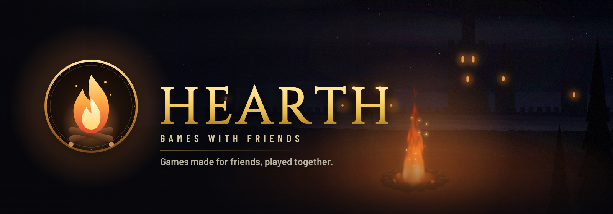

  

  <b>A launcher for the games we make</b>, for a small circle of friends. 
  Get a game in one click · keep it up to date · see who's online · open a lobby and play together

<h2 align="center">Get Hearth</h2>

  

  Windows may say <i>Windows protected your PC</i>: click <i>More info</i>, then <i>Run anyway</i>. 
  Hearth is invite only: a friend who already has it gives you an invite code the first time you open it.

<table align="center">
  <tr>
    <td align="center" width="25%"><b>One click</b> Every game in one Library: get it, play it, and Hearth keeps it up to date</td>
    <td align="center" width="25%"><b>Small, signed updates</b> Downloads only the files that changed, and installs only releases signed by the Hearth key</td>
    <td align="center" width="25%"><b>Friends &amp; lobbies</b> See who's online and what they play, chat, and start a game together from a lobby</td>
    <td align="center" width="25%"><b>Saves kept safe</b> Your saves stay apart from the game, and Backups lets you go back to an older version</td>
  </tr>
</table>

<h2 align="center">The games</h2>

<table align="center">
  <tr>
    <td width="160" align="center"></td>
    <td>
      <b>Kindle &amp; Keep</b> &nbsp;CO-OP BUILD &amp; DEFEND · 1–4 PLAYERS · IN THE WORKS  
      Keep the hearthfire burning through the night. By day, build walls and towers inside the fire's light;
      when the dark comes, hold them together until dawn. 
      Made with Tinderbox, Hearth's own engine.
    </td>
  </tr>
</table>

  
<b>What is in this repository</b>

   

  - `channels/`: the signed game lists Hearth reads (`stable`, and `beta` for testers).
  - The games' files and Hearth's installers are not in git: they are on Cloudflare R2 (the address is in each
    game list), one object per version of each file, named by its SHA-256.

  Hearth reads the game lists straight from `raw.githubusercontent.com`. A game list whose signature doesn't
  match the key built into Hearth is refused, and so is any file whose SHA-256 doesn't match the list. Hearth's
  own updates are signed too, with a key of their own.

  
<b>Privacy</b>

   

  - Game lists come from this repository on GitHub, and the files from Cloudflare R2, like any download.
  - With an invite, Hearth connects to the Hearth server for friends, chat and lobbies. The server keeps your
    chosen name, your friends list and your direct messages. Who's online, what they play, lobbies and lobby
    chat are only kept while the server runs.
  - There are no passwords: Hearth keeps a sign-in token in the Windows credential store. There is no tracking,
    no analytics and no ads.

Made by <a href="https://github.com/tsumilo">tsumilo</a>, for friends.

